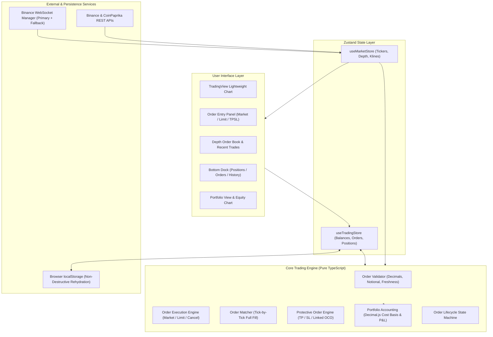

# TradePulse

> Real-Time Cryptocurrency Trading & Portfolio Management Terminal built with React, TypeScript, and WebSockets.

TradePulse is a high-performance, professional cryptocurrency paper-trading platform. It connects directly to live Binance WebSocket streams and REST APIs to provide real-time institutional-grade charts, order books, and price feeds, paired with a client-side simulated matching engine and mathematical accounting system.

---

## Table of Contents

- [Overview](#overview)
- [Key Features](#key-features)
- [Technology Stack](#technology-stack)
- [System Architecture](#system-architecture)
- [Trading Engine & Financial Accounting](#trading-engine--financial-accounting)
- [Installation & Quick Start](#installation--quick-start)
- [Testing & Quality Assurance](#testing--quality-assurance)
- [User Interface Overview](#user-interface-overview)
- [Security & Paper-Trading Limitations](#security--paper-trading-limitations)
- [License](#license)

---

## Overview

TradePulse bridges the gap between static crypto portfolio trackers and live production exchanges. Users can execute simulated market orders, place resting limit orders with automated tick matching, configure protective Stop-Loss and Take-Profit exits (including linked One-Cancels-the-Other / OCO pairs), and monitor detailed portfolio equity metrics with zero real-capital risk.

All financial calculations, order book evaluations, and balance state transitions execute client-side using deterministic decimal arithmetic with zero IEEE-754 floating-point rounding errors.

---

## Key Features

### 1. Real-Time Market Data
- **Live Candlestick Charts**: Integrated TradingView Lightweight Charts (v4.2.3) supporting multi-timeframe analysis (1m, 5m, 15m, 1h, 4h, 1D).
- **Live Order Book & Spread**: Real-time Level 2 depth streaming with visual bid/ask volume depth bars and spread calculation.
- **WebSocket Streaming with Failover**: Dual-endpoint architecture utilizing Binance's primary WebSocket stream (`stream.binance.com`) with automated fallback to `data-stream.binance.vision`.
- **Market Rankings & Stats**: 24-hour volume, price changes, high/low tracking, and global crypto market metrics via CoinPaprika.

### 2. Full-Featured Trading Engine
- **Market Orders**: Instant simulated spot execution against executable quotes (Ask for Buy, Bid for Sell).
- **Limit Orders**: Resting limit orders placed with atomic fund/holding reservations and evaluated tick-by-tick against live market prices.
- **Protective Exits (TP / SL / OCO)**: Long position protection with independent Stop-Loss, Take-Profit, or linked OCO pairs. Shared reservations prevent double-locking of assets, and filling or canceling one leg automatically handles the sibling leg.
- **Order Cancellation**: Idempotent order cancellation releasing locked funds or asset quantities atomically without risk of duplicate release.

### 3. Rigorous Balance & Position Accounting
- **Dual-Layer Reservations**: Separate tracking of available vs. reserved USDT (for limit buys) and available vs. reserved crypto holdings (for limit sells and protective orders).
- **Weighted-Average Cost Basis**: Acquisition costs (including capitalized fees) are tracked across partial and multi-stage buys.
- **Proportional Realized P&L**: Selling positions releases cost basis proportionally and credits net proceeds (gross value minus 0.05% simulated fee) to virtual USDT cash.
- **Mark-to-Market Valuation**: Continuous real-time portfolio valuation reflecting live bid prices.

### 4. Reliability & Safety Guards
- **Atomic Concurrency Mutex**: Guards order submissions against double-clicks and concurrent event-loop executions.
- **Strict Numeric Validation**:
  - Maximum 8 decimal places for cryptocurrency quantities (Satoshi precision).
  - Magnitude-based price precision limits (2 decimals for $\ge \$1$, 4 decimals for $\ge \$0.001$, 8 decimals for $< \$0.001$).
  - Minimum order notional of $1.00 USDT.
  - Rejection of `NaN`, `Infinity`, negative, zero, and extreme overflow numbers before any state mutation.
- **Stale Quote Protection**: Orders are automatically blocked if WebSocket quotes are disconnected, missing, or older than 60 seconds.
- **Non-Destructive Rehydration**: State persists in `localStorage` via Zustand with custom reconciliation that recalculates reservations directly from open orders upon page reload or multi-tab updates.

---

## Technology Stack

| Layer | Technology | Purpose |
| :--- | :--- | :--- |
| **Frontend Framework** | React 18.3 | Reactive component architecture |
| **Language** | TypeScript 5.7 | Static typing and interfaces |
| **Build Tooling** | Vite 6.4 | Fast module bundling and dev server |
| **State Management** | Zustand 5.0 | High-performance state and persistence |
| **Server State / Cache** | TanStack Query v5 | REST API caching and query deduplication |
| **Financial Math** | Decimal.js 10.6 | Arbitrary-precision decimal arithmetic |
| **Charting Engine** | Lightweight Charts 4.2.3 | TradingView financial charting |
| **Styling** | Tailwind CSS 3.4 | Terminal dark theme and layout |
| **Icons** | Lucide React | Trading interface icons |
| **External Feeds** | Binance WebSockets & REST | Real-time market ticks, depth, and historical klines |
| **Market Statistics** | CoinPaprika API | Global crypto metrics and asset rankings |
| **Test Framework** | Vitest 3.2 + Testing Library | Automated unit, component, and E2E safety tests |

---

## System Architecture



---

## Trading Engine & Financial Accounting

TradePulse eliminates floating-point representation errors by executing all balance, fee, and position mathematics using `Decimal.js` with `ROUND_HALF_UP` rounding.

### 1. Cost Basis Accumulation (Buy)
When buying cryptocurrency, trading fees (0.05%) are capitalized into the total position cost basis:

$$\text{Total Cost Basis}_{new} = \text{Total Cost Basis}_{old} + (\text{Gross Execution Value} + \text{Trading Fee})$$

$$\text{Average Entry Price} = \frac{\text{Total Cost Basis}_{new}}{\text{Total Quantity}_{new}}$$

### 2. Proportional Cost Basis & Realized P&L (Sell)
When closing or trimming a position, cost basis is deducted proportionally:

$$\text{Sold Cost Basis} = \left(\frac{\text{Quantity Sold}}{\text{Position Quantity}_{old}}\right) \times \text{Total Cost Basis}_{old}$$

$$\text{Net Proceeds} = \text{Gross Execution Value} - \text{Trading Fee}$$

$$\text{Realized P&L} = \text{Net Proceeds} - \text{Sold Cost Basis}$$

### 3. Balance Invariant
Virtual USDT cash and cryptocurrency holdings maintain a strict reservation invariant at all times:

$$\text{Available Balance} = \max(0, \text{Total Balance} - \text{Reserved Balance})$$

- **Limit Buys** reserve: $(\text{Limit Price} \times \text{Quantity}) \times (1 + \text{Fee Rate})$.
- **Limit Sells & Protective Orders** reserve: $\text{Quantity}$ of base cryptocurrency.
- **Linked OCO Orders** share a single reservation per group, preventing double-locking.

---

## Installation & Quick Start

### Prerequisites
- [Node.js](https://nodejs.org/) (version 18.0 or higher recommended)
- `npm` (version 9 or higher)

### Setup Instructions

1. **Clone the repository**:
   ```bash
   git clone https://github.com/Anav-000/TradePulse.git
   cd TradePulse
   ```

2. **Install dependencies**:
   ```bash
   npm install
   ```

3. **Start the local development server**:
   ```bash
   npm run dev
   ```
   The terminal will be accessible at `http://localhost:3000/`.

4. **Build for production**:
   ```bash
   npm run build
   ```
   Compiles TypeScript and generates optimized static assets in `dist/`.

5. **Preview production build locally**:
   ```bash
   npm run preview
   ```

---

## Testing & Quality Assurance

TradePulse includes an automated test suite with 100% pass rate across 20 test files (164 tests), covering the trading engine, UI components, data normalizers, and edge cases.

### Run Test Suite
```bash
npm test
```

### Deterministic Safety Test Suite (T01 – T25)
Located in `src/features/trading/engine/tradingEngineSafety.test.ts`, this suite verifies critical financial edge cases:
- **T01**: Concurrency and duplicate submission protection.
- **T02**: Stale quote rejection ($> 60$ seconds).
- **T03 – T05**: Limit order matching, order book spread crossing, and cancellation releases.
- **T06 – T08**: Linked OCO creation, sibling leg cancellation, and trigger execution.
- **T09 – T11**: Cost-basis capitalization, fee deductions, and realized P&L accuracy.
- **T12**: Numeric edge cases (`NaN`, `Infinity`, 9+ decimal places, sub-$1 notional, overflow values).
- **T13 – T25**: Multi-tab synchronization, rehydration recovery, and zero-state mutation on invalid orders.

---

## User Interface Overview

TradePulse is structured as an integrated financial trading desk:

1. **Top Navigation & Market Header**:
   - Live ticker tape displaying active cryptocurrency prices, 24h change percentages, 24h high/low, and 24h volume.
   - Connection status pill (Connected / Stale / Disconnected) with latency indicator.
   - Virtual wallet summary displaying Total Equity, Available USDT, and Reset Account action.

2. **Main Trading Workspace**:
   - **Central Candlestick Chart**: Interactive TradingView candlestick and volume chart with timeframe selector.
   - **Right Order Entry Panel**: Tabbed interface for Market, Limit, and TP/SL (OCO) orders with live cost estimation, percentage presets (25%, 50%, 75%, 100%), and dynamic validation error messages.
   - **Order Book & Live Market Trades**: Real-time Level 2 depth table with click-to-fill price selection.

3. **Bottom Dock**:
   - **Positions**: Active holdings, quantity, entry price, mark price, unrealized P&L ($ / %), and quick Market Close button.
   - **Open Orders**: Pending limit orders and active TP/SL triggers with individual and group cancellation actions.
   - **Trade History**: Chronological log of simulated fills with fees and realized P&L.

4. **Portfolio Analytics View**:
   - Equity progression chart tracking account valuation over time.
   - Asset allocation donut chart detailing portfolio composition.

---

## Security & Paper-Trading Limitations

- **Simulated Trading Only**: TradePulse is strictly a simulation and paper-trading terminal. It does not execute transactions on any live blockchain or real-money exchange.
- **No Private Keys or Passwords**: The application does not solicit, require, or store private keys, seed phrases, or exchange API secret keys.
- **Public Market Feeds**: All market prices, klines, and depth data are streamed from publicly accessible, unauthenticated endpoints provided by Binance and CoinPaprika.
- **Execution Model**: Orders are matched against real-time top-of-book market prices without generating real exchange liquidity or market impact.

---

## License

This project is licensed under the [MIT License](LICENSE).
