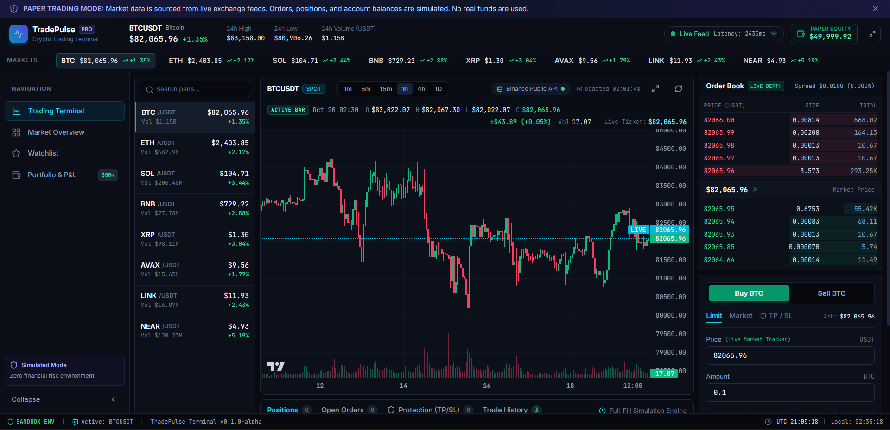
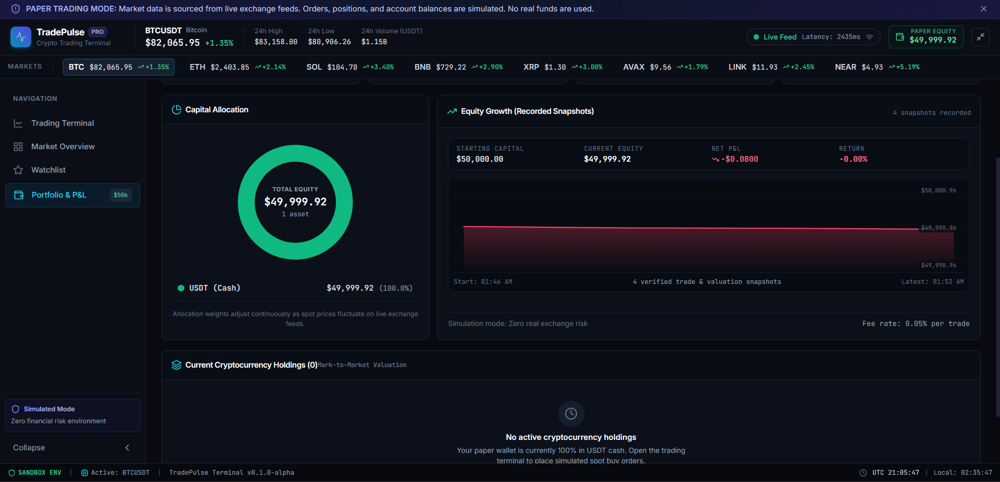
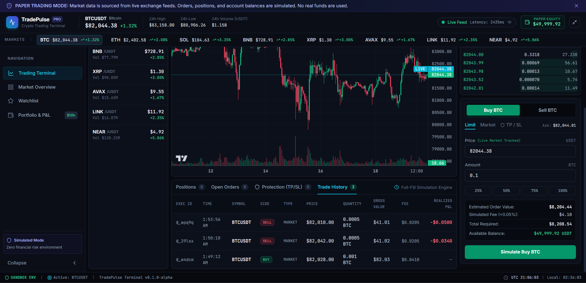
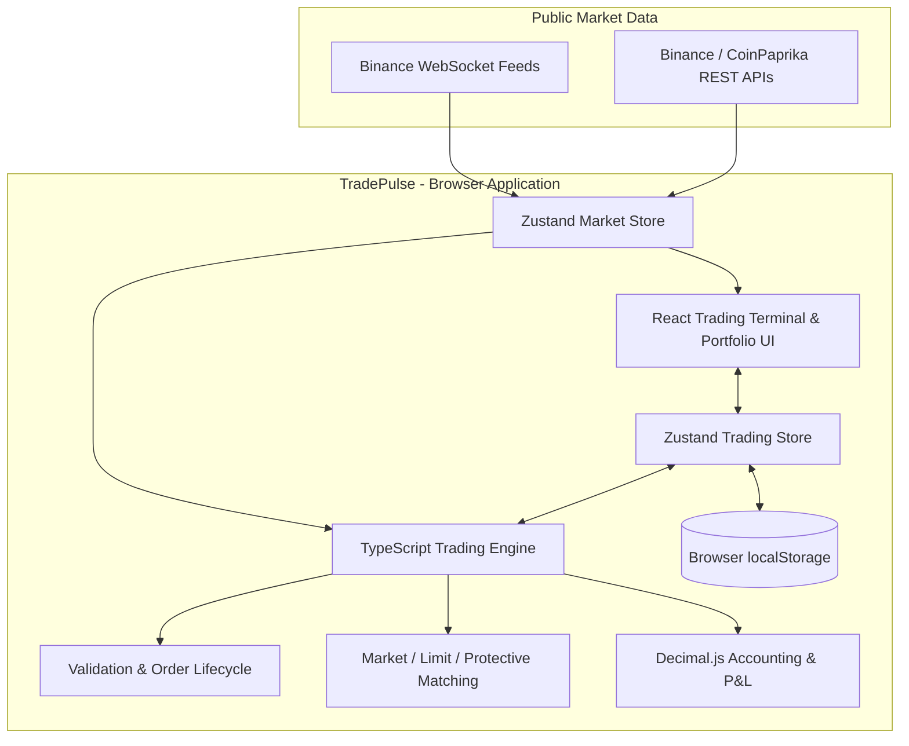

<div align="center">

# 📈 TradePulse

[](https://trade-pulse-ruby.vercel.app)

[](https://github.com/Anav-000/TradePulse)

**[🌐 Explore the Live Application](https://trade-pulse-ruby.vercel.app)**

> **Paper Trading Only:** TradePulse uses live cryptocurrency market data with simulated trades and virtual funds. No real-money transactions are performed.

### Professional Cryptocurrency Paper Trading & Portfolio Analytics Terminal

**Real-time market intelligence. Simulated order execution. Precision portfolio accounting.**

[](https://react.dev/)
[](https://www.typescriptlang.org/)
[](https://vite.dev/)
[](https://zustand.docs.pmnd.rs/)


[**Explore Features**](#-key-features) · [**Screenshots**](#-application-screenshots) · [**Architecture**](#-system-architecture) · [**Get Started**](#-getting-started) · [**Testing**](#-testing--quality-assurance)

**Developed by [Arnav Kumar](https://github.com/Anav-000)**

</div>

> [!IMPORTANT]
> **Paper trading only.** TradePulse uses public cryptocurrency market feeds to simulate spot trading. It does **not** submit orders to an exchange, hold real assets, or involve real money.

---

## 📌 Overview

**TradePulse** is a browser-based cryptocurrency trading terminal that combines live market data with a deterministic, client-side paper-trading engine. It is designed to demonstrate how a modern trading interface can coordinate streaming prices, order lifecycles, virtual balances, position accounting, and portfolio analytics in one responsive workspace.

Rather than connecting to a live brokerage account, TradePulse executes **simulated orders** against market-derived bid/ask quotes. The platform tracks fees, available and reserved funds, weighted-average cost basis, realized and unrealized P&L, and portfolio equity using `decimal.js` for financial arithmetic.

### Highlights

- **Live market monitoring** using Binance WebSocket streams and public REST endpoints.
- **Interactive trading workspace** with candlestick charts, depth order book, and market statistics.
- **Market and limit order simulation**, including order validation, matching, and cancellation.
- **Stop-loss, take-profit, and linked OCO exits** for simulated long positions.
- **Portfolio accounting** with virtual USDT balances, holdings, fees, and performance analytics.
- **Browser persistence** with reconciliation of reserved balances on reload.
- **Automated verification:** 164 tests across 20 test files passed in the latest reported audit.

---

## 📸 Application Screenshots

### Trading Terminal

Live cryptocurrency prices, interactive candlestick chart, depth order book, and simulated order entry.



### Portfolio Dashboard

Virtual equity, capital allocation, and recorded equity snapshots.



### Trade Execution & History

Simulated buy/sell order entry alongside execution history, fees, and realized P&L.



---

## ✨ Key Features

| Area | Capabilities |
| --- | --- |
| **Market data** | Live prices, 24-hour statistics, market rankings, candlestick/volume charts, order book depth, and bid/ask spread |
| **Order execution** | Simulated market buys/sells at executable quotes; limit orders matched against incoming price updates |
| **Risk controls** | Stop-loss, take-profit, and linked one-cancels-the-other (OCO) protective orders |
| **Funds management** | Virtual USDT wallet, available/reserved balance tracking, asset reservations, and cancellation release |
| **Positions & P&L** | Weighted-average entry cost, partial/full closures, execution fees, realized/unrealized P&L |
| **Portfolio analytics** | Total equity, capital allocation, holdings, equity snapshots, and trade history |
| **Reliability** | Input validation, stale-quote safeguards, order lifecycle checks, submission protection, and persisted state reconciliation |

### Market data & visualization

- **TradingView Lightweight Charts** for multi-timeframe candlestick and volume visualization.
- **Binance public WebSockets** for streaming market information, with a fallback connection strategy.
- **Live depth visualization** showing bids, asks, and spread.
- **Market summaries** from public market-data services, including CoinPaprika.

### Simulated trading & order lifecycle

- **Market orders:** simulated fills against the current executable ask (buy) or bid (sell), subject to validation and quote freshness.
- **Limit orders:** pending orders reserve the required funds or assets and fill when market-derived prices meet the limit condition.
- **Protective exits:** stop-loss and take-profit triggers, including OCO-linked legs that coordinate cancellation and shared asset reservations.
- **Order history:** simulated executions with price, quantity, gross value, fees, and realized P&L where applicable.

### Portfolio management

- Virtual USDT capital and cryptocurrency holdings.
- Reservation-aware available balances for open orders.
- Mark-to-market portfolio valuation using current market prices.
- Asset allocation and historical equity snapshots.
- Browser-local persistence for paper-trading state.

---

## 🧰 Technology Stack

| Layer | Technology | Role |
| --- | --- | --- |
| Frontend | React 18, TypeScript 5 | Component-based interface and type safety |
| Build tooling | Vite 6 | Development server and production bundling |
| Styling | Tailwind CSS 3 | Dark terminal styling and responsive layout |
| State management | Zustand 5 | Trading and market state; persistence |
| Async data | TanStack React Query 5 | Public REST data fetching and caching |
| Financial calculations | Decimal.js | Decimal arithmetic for balances, fees, and P&L |
| Financial charts | TradingView Lightweight Charts | Candlestick and volume charting |
| Market feeds | Binance WebSocket / REST | Market quotes, depth, and historical candles |
| Market metrics | CoinPaprika API | Broader cryptocurrency market statistics |
| Icons | Lucide React | Interface iconography |
| Testing | Vitest, React Testing Library | Unit, integration, and component verification |

---

## 🏗️ System Architecture

TradePulse is a **client-side single-page application**. The trading engine runs in the browser; public exchange endpoints provide market data but do not execute the simulated orders.



### Design principles

1. **Separation of concerns:** UI components, state stores, market-data adapters, and financial calculations are organized into distinct modules.
2. **Deterministic financial operations:** decimal-based calculations reduce floating-point representation issues in balances and fees.
3. **Explicit order lifecycle:** order validation, execution, cancellation, and protective-order coordination are modeled as state transitions.
4. **Persistence with reconciliation:** on reload, reserved balances can be recalculated from active orders rather than trusted blindly from cached totals.

---

## ⚙️ Trading Engine & Financial Accounting

### Order execution model

For simulated spot orders, TradePulse uses market-derived executable quotes:

| Order | Simulated execution rule |
| --- | --- |
| Market buy | Buy against current ask, subject to sufficient virtual USDT |
| Market sell | Sell against current bid, subject to available asset quantity |
| Limit buy | Eligible when the ask is at or below the limit price |
| Limit sell | Eligible when the bid is at or above the limit price |
| Stop-loss / take-profit | Triggered by the configured price conditions; simulated exit follows engine rules |

**Important:** This is a simplified, full-fill simulation. It does not model exchange queue position, partial liquidity fills, real slippage, market impact, or actual exchange settlement.

### Fee and cost-basis model

The current simulator uses a **0.05% simulated fee per executed trade**.

For a buy:

```text
Gross Buy Value  = Execution Price × Quantity
Buy Fee          = Gross Buy Value × 0.0005
New Cost Basis   = Previous Cost Basis + Gross Buy Value + Buy Fee
Average Cost     = Total Cost Basis / Total Position Quantity
```

For a partial or full sell:

```text
Gross Sale Value = Execution Price × Quantity Sold
Sell Fee         = Gross Sale Value × 0.0005
Allocated Cost   = Previous Cost Basis × (Quantity Sold / Previous Quantity)
Realized P&L     = Gross Sale Value − Sell Fee − Allocated Cost
```

Portfolio equity is calculated conceptually as:

```text
Total Equity = Virtual USDT Balance + Σ (Asset Quantity × Current Mark Price)
```

### Reservation safeguards

- **Limit buys** reserve the virtual USDT needed for the order, including estimated fees.
- **Limit sells and protective exits** reserve the relevant cryptocurrency quantity.
- **OCO-linked exits** share the appropriate reservation to avoid double-locking holdings.
- **Cancellations** release reservations without crediting the same funds twice.

---

## 🚀 Getting Started

### Prerequisites

- [Node.js](https://nodejs.org/) — a current supported LTS release is recommended.
- npm (included with Node.js).
- Internet access to reach public market-data endpoints.

### 1. Clone the repository

```bash
git clone https://github.com/Anav-000/TradePulse.git
cd TradePulse
```

### 2. Install dependencies

```bash
npm ci
```

### 3. Start the development server

```bash
npm run dev
```

Open the local address printed by Vite in your terminal (configured as `http://localhost:3000` in the reviewed project).

### 4. Create a production build

```bash
npm run build
```

The static production files are generated in `dist/`.

### 5. Preview the production build

```bash
npm run preview
```

> No private Binance API key or real trading account is required for the paper-trading features described here.

---

## 🧪 Testing & Quality Assurance

The latest reported local audit (October 2026) recorded:

| Check | Reported result |
| --- | --- |
| Automated tests | **164 passed / 164 total** |
| Test files | **20 passed / 20 total** |
| TypeScript compilation | **0 errors** |
| Production build | **Successful** |
| Production dependency audit | **0 known vulnerabilities** from `npm audit --omit=dev` at audit time |

Run the automated tests:

```bash
npm test
```

Coverage areas include order validation, fee calculations, market/limit matching, protective OCO behavior, state transitions, portfolio accounting, data normalization, and UI workflows. A dedicated trading safety test file exercises scenarios such as duplicate submissions, stale quotes, invalid numerical inputs, and cancellation behavior.

> These figures describe the latest reported audit, not a continuously updated CI badge. Dependency advisories and test results may change over time.

---

## 📁 Project Structure

```text
TradePulse/
├── public/
│   └── screenshots/
│       ├── trading-terminal.png
│       ├── portfolio-dashboard.png
│       └── trade-history.png
├── src/
│   ├── features/
│   │   ├── trading/          # Order entry, trading engine, state, tests
│   │   ├── portfolio/        # Portfolio analytics and visualizations
│   │   ├── market/           # Market views and rankings
│   │   └── terminal/         # Terminal workspace components
│   ├── services/             # REST and WebSocket integrations
│   ├── stores/               # Shared application state
│   └── lib/                  # Shared utilities
├── index.html
├── package.json
├── package-lock.json
├── vite.config.ts
├── vitest.config.ts
└── README.md
```

*Simplified directory overview; see the repository for the complete source tree.*

---

## 🌐 Deployment

TradePulse can be deployed as a **static Vite application** on platforms such as Vercel or Netlify.

Typical build settings:

| Setting | Value |
| --- | --- |
| Framework | Vite |
| Build command | `npm run build` |
| Output directory | `dist` |
| Project root | Repository root |

After deployment, verify that live market feeds, chart history, WebSocket connections, order simulation, and browser refresh behavior work on the hosted domain. Public market-data services may apply network, geographic, rate-limit, or availability restrictions.

**Live demo:** Not deployed yet — add the verified URL here after deployment.

---

## 🔐 Security & Simulation Limitations

- **No real trades:** Orders and account balances are simulated entirely within the application.
- **No custody:** TradePulse does not manage real funds, private keys, seed phrases, or exchange credentials.
- **Browser-local data:** Portfolio and order state are stored in browser `localStorage`; they are not a secure or authoritative ledger and do not automatically synchronize between devices.
- **Market-data dependencies:** Real-time functionality depends on the availability and accessibility of external public endpoints.
- **Simplified execution:** Fills are simulated using available quote data and should not be interpreted as achievable live-exchange execution prices.
- **Not investment advice:** The project is for learning, demonstration, and software engineering portfolio purposes.

---

## 🗺️ Future Enhancements

Potential directions for future development include:

- Optional backend persistence and authenticated user accounts.
- Cross-device synchronization of simulated portfolios.
- More realistic execution modeling, including slippage and partial fills.
- Additional performance analytics and trade journal features.
- Continuous integration for tests and production builds.
- Accessibility and mobile layout refinements.

These are **planned ideas**, not features claimed to be implemented.

---

## 👨‍💻 Author

**Arnav Kumar**  
Software Development · Full-Stack Applications · Financial Technology

- **GitHub:** [@Anav-000](https://github.com/Anav-000)
- **Project repository:** [TradePulse](https://github.com/Anav-000/TradePulse)

If you find the project useful, consider giving the repository a ⭐.

---

<div align="center">

**Built by Arnav Kumar — TradePulse | Learn the markets. Test the strategy. Risk no real capital.**

</div>
